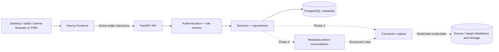

# System architecture

> Historical Phase 1 design snapshot. The current integration release extends this architecture and replaces the old palette. See [current architecture, connector contracts, and execution behavior](integrations.md).

Phase 1 is an executable foundation, not the completed reconciliation platform. Next.js 16 App Router and React 19 render a single responsive web/PWA frontend. FastAPI validates requests, enforces sessions/roles, and uses SQLAlchemy 2 with psycopg 3 to access PostgreSQL 18. Alembic owns schema changes. Actual business datasets stay in configured external databases or authorized file storage.

## Frontend

- `app`: root metadata, manifest, login, route validation, and global two-color styles.
- `components`: navigation shell, state feedback, reusable TanStack inventory, and PWA registration.
- `features`: dashboard, settings/administration, and API-backed metadata module inventories.
- `hooks`: session loading and expired-session redirect.
- `services`: centralized fetch client, cookie credentials, consistent errors, and no-store policy.
- `types`: typed account, metadata inventory, system health, and summary responses.
- `public`: two-color SVG/PNG icons, install manifest, network-only navigation service worker, and offline page.

CSS uses only #0EA5E9 and #FFFFFF, plus alpha variations. Tailwind 4 is integrated; custom CSS defines consistent reusable layout/components. Recharts renders actual outcomes only when there are results; the empty workspace displays explanatory empty states. TanStack Table renders paginated server inventories. React Flow is intentionally scheduled for Phase 3, with a mobile mapping form planned alongside it. No mock results, unrestricted SQL input, or inactive action buttons.

## Backend

Routers call typed Pydantic schemas, security dependencies, services, and repositories. One request-scoped SQLAlchemy session handles each operation. Read queries use bound expressions; writes commit account changes and their audit entries together. Database statement timeout is 10 seconds, connection timeout 5 seconds, inventory limit 100 rows. Connector/ingestion/engine boundaries are documented in their package directories; no Phase 2+ execution is enabled.

Production must use a separate migration owner, a restricted metadata runtime role, encrypted backups, secret injection, TLS termination, and an ingress rate limiter. The native development database role owns its isolated local cluster and must never be reused for production. The current in-process sign-in limiter is suitable for a single development worker; it is not a distributed rate limiter. This foundation is single-workspace: users share authorized metadata. Multi-tenant isolation is outside this scope.

## Authentication and permissions

Accounts are provisioned by a one-time interactive bootstrap command, then by authenticated administrators. Passwords are Argon2 hashes. Sessions are short-lived HS256 JWTs in HttpOnly/SameSite=Lax cookies. JWT issuer/audience/expiry and account active/token-version are checked for each request. Logout increments token_version to revoke replay of existing sessions for that account. Origin checks protect every mutation, including login. User preferences use a validated schema; credentials/hashes are never included in response serializers.

| Role | Phase 1 capabilities | Future workflow capabilities |
|---|---|---|
| Viewer | Read metadata/dashboard; own preferences | Authorized previews and reports |
| Engineer | Read metadata/dashboard; own preferences | Manage tables/mappings, ingest, execute reconciliation |
| Administrator | Above + provision users | Manage connections and authorized platform configuration |

Fernet authenticated encryption helpers and an environment-supplied key are implemented and tested for future connector secrets. External connector credentials are not collected yet. Credential references will be resolved server-side. No passwords in URLs, browser storage, audit fields, or logs. HTTPS and Secure cookies are required by configuration in production. OpenAPI is disabled there by default.

## Execution design for later phases

For ingestion, a config defines selected columns, source, destination, full/incremental mode, and watermark. Bounded workers persist queued/running/succeeded/failed runs. Watermarks advance only after destination commit. Before enabling unbounded data jobs, add a durable queue and enforce cancellation/time/resource limits. This is not an ETL orchestrator.

Mappings comprise target branches (`mapping_edges`) and normalized source memberships (`mapping_sources`). A one-to-many mapping has one source on each of several target branches; a many-to-one mapping has several sources joining into one branch. Each branch holds its own keys, filters, joins, aggregations, column maps, and transformations. These two additional metadata tables are necessary to represent the required cardinalities without encoding table foreign keys inside JSON.

Rules are structured allowlisted expressions, never arbitrary SQL or Python. Each branch compares data at its configured grain, after filters/transforms/aggregation. Duplicate keys are reported instead of silently collapsed. Null/type/numeric/timestamp behavior must be explicit. A run stores a configuration snapshot so results remain explainable after edits. Per-target results remain separate; an eventual overall source-record coverage summary must union source identities across branches. Phase 1 dashboard sums latest successful *table comparisons* per job and labels that scope; it does not claim a unique-source fan-out summary.

Bronze/Silver/Gold are fixed seeded layer metadata, assigned to registered tables. PostgreSQL schemas can represent these layers initially. Adapters can later implement Delta Lake/Databricks without changing the mapping contract. Connector registry extension points will support Snowflake, Azure SQL/ADLS, Redshift, BigQuery, and Oracle without exposing unrestricted query endpoints.

## Compatibility and accessibility

Next.js documents [Node >=20.9 and modern Chrome/Edge/Safari browser support](https://nextjs.org/docs/app/getting-started/installation). This project targets Node 24 and Python 3.13, with dependencies frozen by package-lock.json and requirements.txt. [PostgreSQL's supported releases](https://www.postgresql.org/support/versioning/) inform the PostgreSQL 18 choice. API structure follows the [FastAPI relational database guidance](https://fastapi.tiangolo.com/tutorial/sql-databases/) and [JWT/password guidance](https://fastapi.tiangolo.com/tutorial/security/oauth2-jwt/).

Responsive breakpoints provide a fixed desktop sidebar and mobile menu, stacked cards/forms, scrollable data tables, semantic forms, keyboard focus outlines, reduced-motion support, skip navigation, and live error/status messages. PWA support requires HTTPS or localhost. iOS installation uses Safari's Add to Home Screen. Offline mode deliberately cannot display business data.

**Palette conflict:** #0EA5E9 against #FFFFFF has approximately 2.77:1 contrast, below WCAG AA's 4.5:1 normal-text and 3:1 large-text minimums. Opacity variations cannot increase that contrast. Strict compliance with both the two-color rule and sufficient text contrast is mathematically impossible. The requested palette is preserved; no WCAG conformance claim is made. Approval of a darker text color would be needed to resolve this. Larger/heavier labels and focus outlines help usability but do not fix the contrast ratio.

## Phase gates

1. Foundation: production build, real PostgreSQL migration + rollback + drift checks, authenticated API integration tests, and browser workflow smoke tests.
2. Connections/tables: authorized connector testing, schema/identifier validation, secure upload parsing, ingestion fixtures and transaction behavior.
3. Mapping/layers: cardinality, branch-specific config, joins, drag-and-drop, touch form, lineage tests.
4. Engine: count/schema/row/column/duplicates/null/aggregate/transform/tolerance tests, real connectors, fan-out coverage without double counts.
5. Results: drill-downs, trend queries, exports, data explorer, responsive visualization tests.
6. Deployment: HTTPS hardening, Docker validation, OS/device/browser matrix, load and security review.

Do not advance to Phase 2 until the documented Phase 1 checks pass. Cross-platform emulation is evidence of layout/engine behavior, not a substitute for physical device verification.
