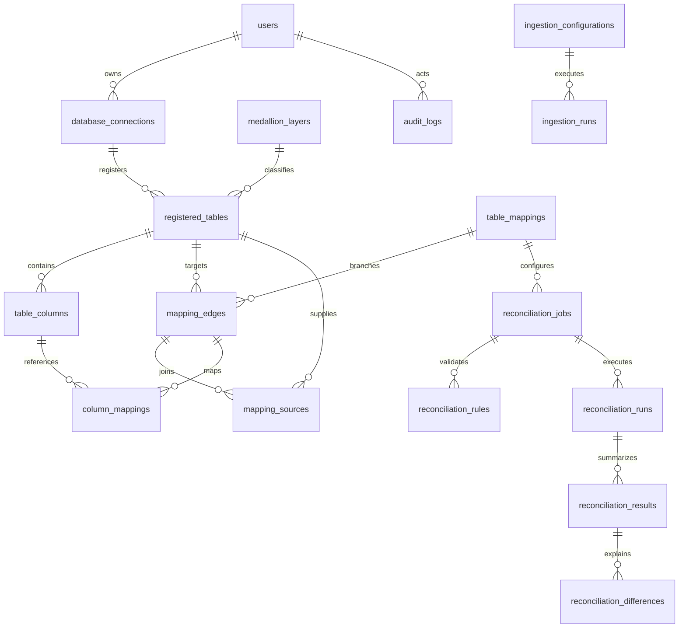

# PostgreSQL metadata schema

The current database includes the 18 foundation tables described below plus seven integration tables from `0002_integrations`: `external_applications`, `integration_connections`, `integration_auth_configurations`, `integration_resources`, `integration_sync_configurations`, `integration_sync_runs`, and `integration_errors`. Migration `0003_files` adds the CSV catalog entry. The application migration head is `0003_files`; account and existing table metadata are preserved.

Integration metadata links applications, user-owned encrypted authentication, exposed resources, registered tables, destinations, immutable sync configurations/watermarks, execution runs and sanitized errors. Actual uploaded datasets are encrypted in authorized server storage. Incremental destination bookkeeping lives in `_reconcile_sync_ledger` inside the separately authorized data database, not the central metadata database.

Migration `0001_foundation` creates all 16 requested tables plus two normalized mapping membership tables. UUID primary keys and UTC-aware created/updated timestamps are present throughout. `updated_at` is refreshed by SQLAlchemy updates; external direct SQL writers must set it explicitly. JSONB holds structured rule/configuration/snapshot content; table identity, edges, columns, and ownership use foreign keys.

| Table | Purpose and principal fields |
|---|---|
| users | Unique email, display name, password_hash, role, active, token_version, preferences |
| database_connections | Name/type/source-target, host/port/database/schema, authentication method, username, encrypted credential or reference, description, owner |
| registered_tables | Connection FK, database/schema/table identity, description, source-target, layer FK |
| table_columns | Table FK, unique column name/ordinal, type, primary key, nullable, default |
| ingestion_configurations | Source/destination connections and tables, ingestion type, mode, options, watermark column/value, owner |
| ingestion_runs | Configuration FK, actor, status, counts, started/completed timestamps, sanitized errors |
| table_mappings | Name/type/version/description/owner |
| mapping_edges | Mapping FK, target table FK, per-target keys/joins/filters/aggregations |
| mapping_sources | Edge FK + source table FK, unique membership |
| column_mappings | Edge FK, source/target column FKs, structured transformation |
| reconciliation_jobs | Name, mapping FK, owner, enabled flag |
| reconciliation_rules | Job FK, optional branch FK, rule type, configuration |
| reconciliation_runs | Job FK, actor, status, configuration snapshot, execution timestamps/duration/error |
| reconciliation_results | Run/edge unique pair, source/target counts, matched/mismatched/missing/extra/duplicates, match percentage, rule results |
| reconciliation_differences | Result FK, typed business key, difference type, column, source/target value objects |
| medallion_layers | Fixed unique bronze/silver/gold name, description, order |
| audit_logs | Actor, action, resource identity/type, sanitized details, timestamp |

Constraints enforce roles, classification, layer names, valid ports, mapping types, run status, nonnegative result counts, and bounded percentages. Indexes cover association foreign keys and audit actions. Existing table identity is unique per connection/database/schema/table. Connection names are unique in this single workspace.

Source/target row payloads are not part of registered_tables. Difference values are authorized reconciliation evidence, potentially sensitive; retention, masking, preview authorization, and exports must be applied before the engine/results phases are deployed.
